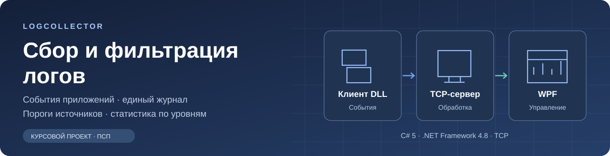
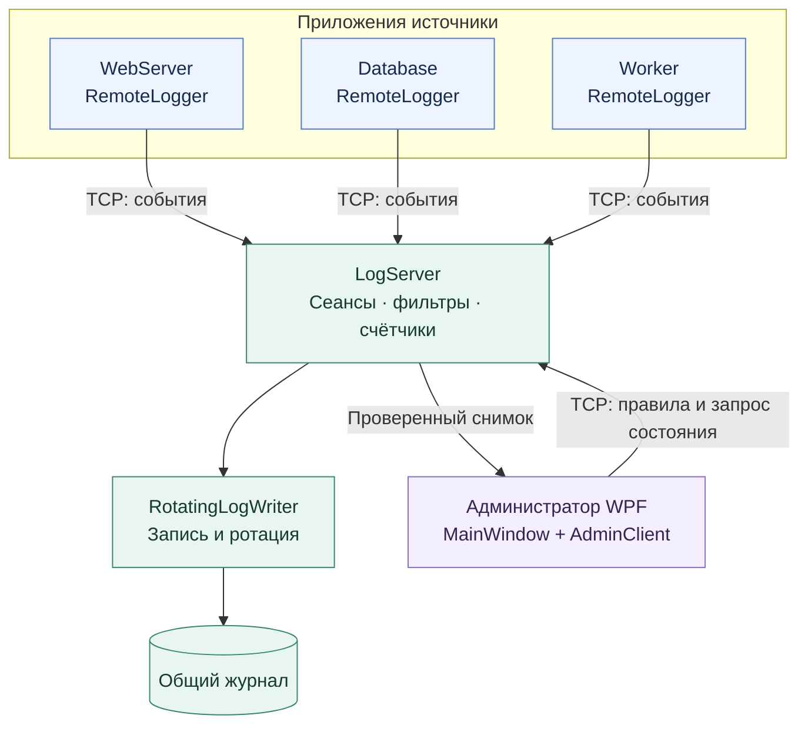
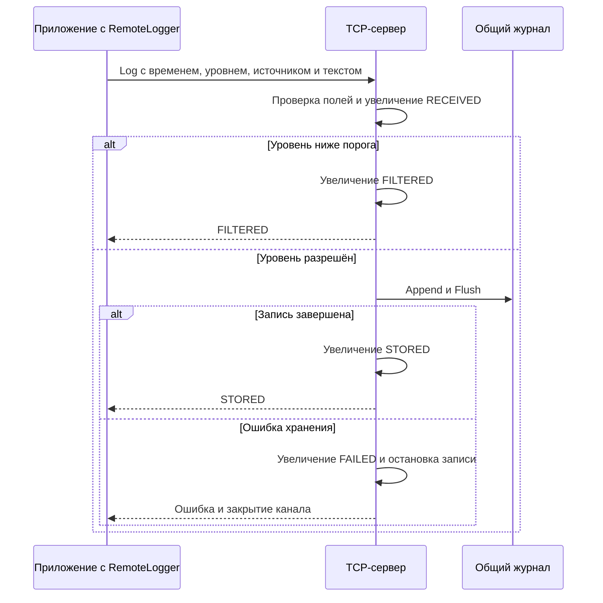
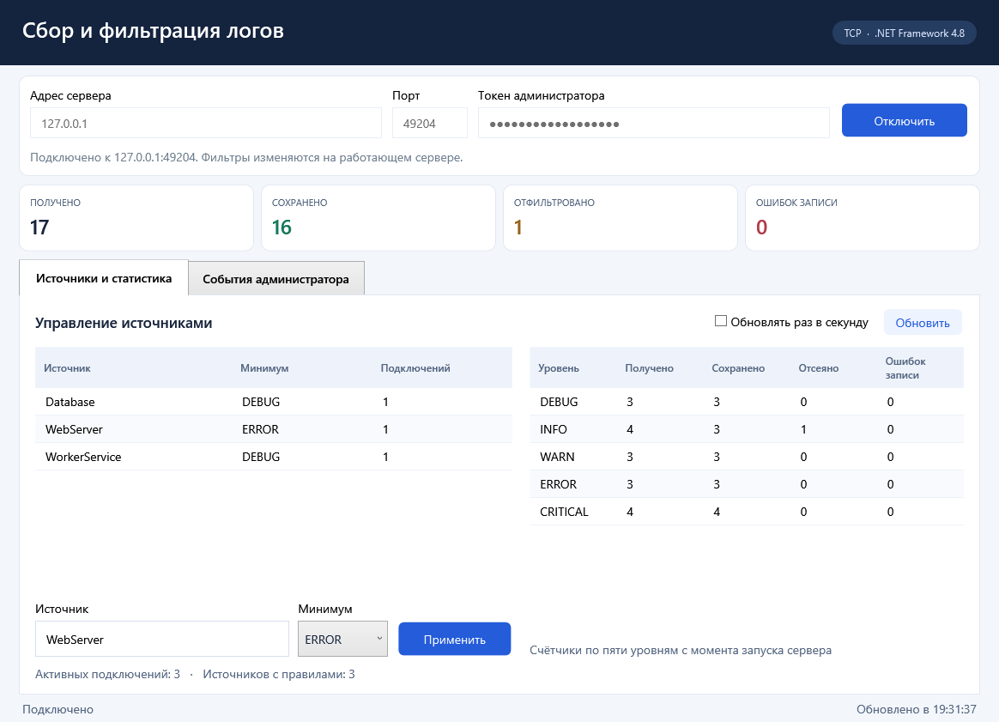
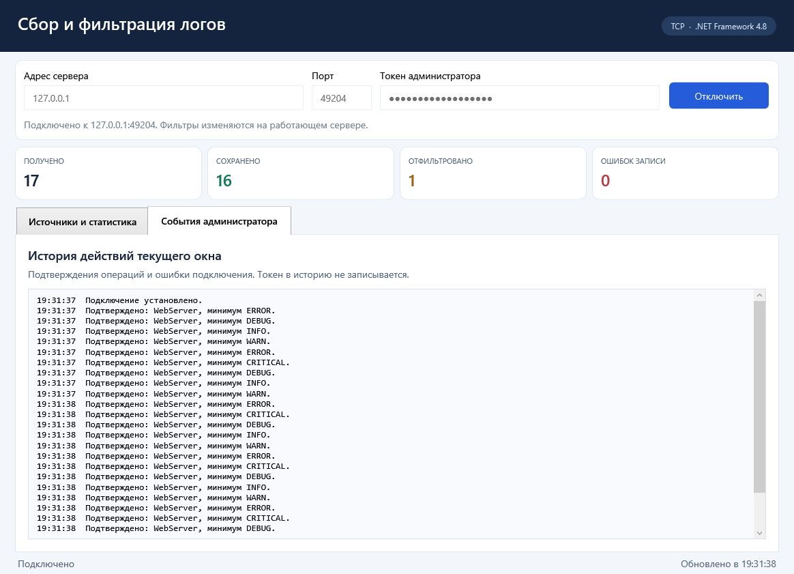
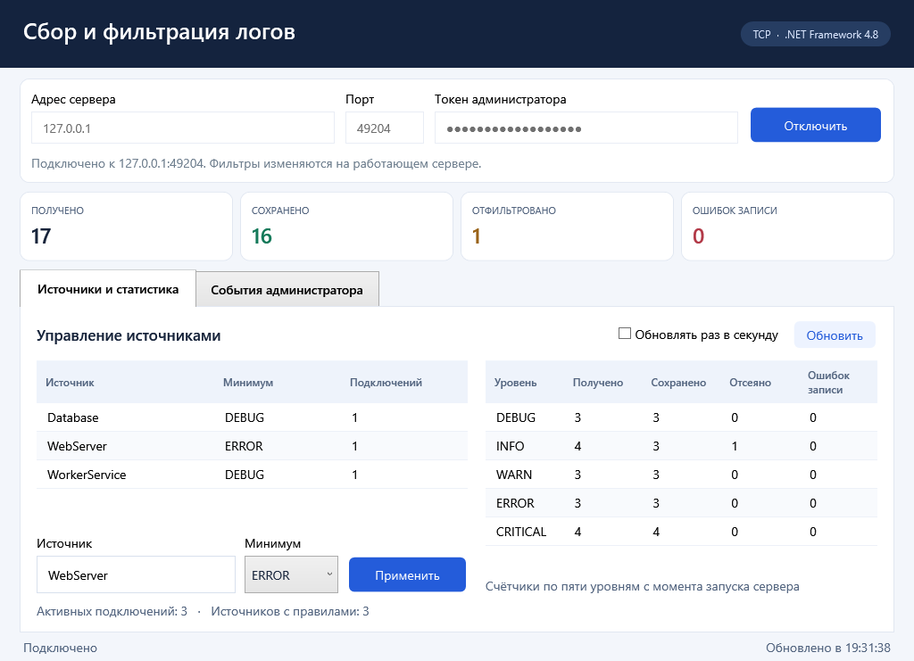
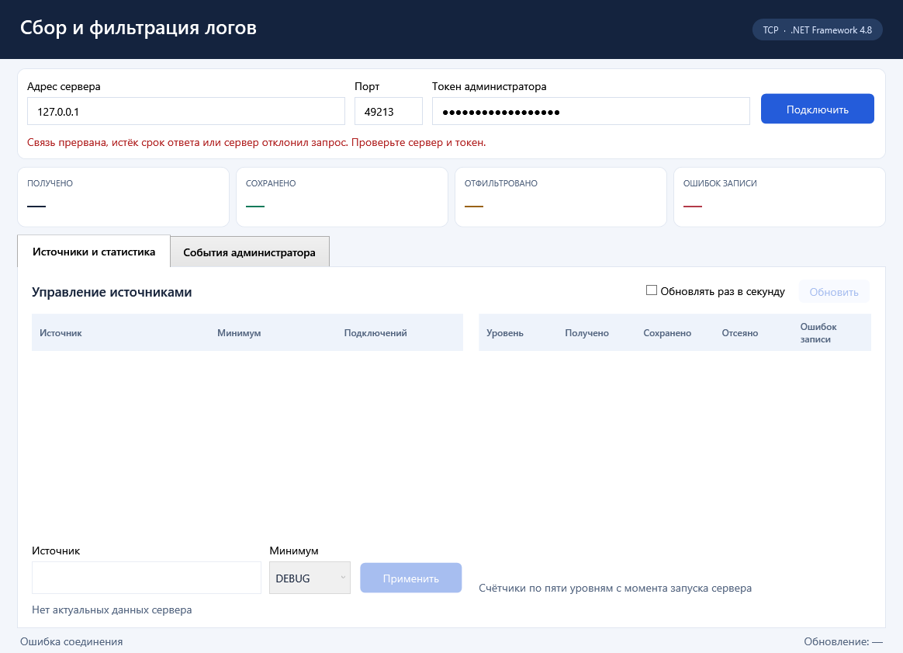

# LogCollector

**Распределённая система сбора и фильтрации логов с агрегацией по уровням.**

Курсовой проект по дисциплине «ПСП»: подключаемая клиентская библиотека, многопоточный TCP-сервер и WPF-приложение администратора. События нескольких приложений поступают в общий журнал, а минимальный уровень каждого источника меняется во время работы.


[Возможности](#возможности) · [Архитектура](#архитектура) · [Интерфейс](#интерфейс) · [Быстрый запуск](#быстрый-запуск) · [Проверки](#проверки) · [Документация](#техническая-документация) · [План проекта](ROADMAP.md)

## Возможности

| Возможность | Как работает |
| --- | --- |
| Несколько приложений | Каждый источник устанавливает TCP-соединение и отправляет события через DLL |
| Пять уровней | `DEBUG < INFO < WARN < ERROR < CRITICAL` |
| Фильтры источников | Минимальный уровень меняется через WPF или консоль администратора |
| Общий журнал | Записи всех источников сохраняются в один поток файлов UTF-8 |
| Ротация | При достижении 10 МиБ открывается следующий сегмент; запись остаётся целой |
| Статистика | Полученные, сохранённые, отфильтрованные записи и ошибки хранения по каждому уровню |
| Работа при сбоях | Проверка кадров, таймауты, закрытие повреждённого канала и восстановление последней неполной строки |
| Интерфейс WPF | Таблицы, карточки итогов, история действий, автообновление и отмена запроса |

Фильтр `ERROR` для `WebServer` сохраняет его события `ERROR` и `CRITICAL`. Другие источники продолжают работать со своими правилами. Агенту не требуется переподключаться после изменения порога.

## Архитектура



Сервер создаёт отдельный поток для каждого подключения. Правила, решение фильтра, запись и изменение счётчиков согласованы общей блокировкой. Администратор получает состояние через TCP; окно работает с проверенным неизменяемым снимком.

| Компонент | Ответственность | Исходники |
| --- | --- | --- |
| `Common` | Модель записи, уровни и бинарный кодек | [LogRecord](src/LogCollector.Common/LogRecord.cs), [Protocol](src/LogCollector.Common/Protocol.cs) |
| `Client` | События, административные запросы и проверка снимка | [RemoteLogger](src/LogCollector.Client/RemoteLogger.cs), [AdminClient](src/LogCollector.Client/AdminClient.cs), [ServerStatus](src/LogCollector.Client/ServerStatus.cs) |
| `Server` | TCP-сеансы, фильтры, агрегаты и журнал | [LogServer](src/LogCollector.Server/LogServer.cs), [RotatingLogWriter](src/LogCollector.Server/RotatingLogWriter.cs) |
| `AdminWpf` | Отображение данных и управление источниками | [MainWindow](src/LogCollector.AdminWpf/MainWindow.cs), [XAML](src/LogCollector.AdminWpf/MainView.xaml) |
| `DemoAgent` | Отдельное приложение с клиентской DLL | [Program](src/LogCollector.DemoAgent/Program.cs) |
| `AdminConsole` | Управление сервером из консоли | [Program](src/LogCollector.AdminConsole/Program.cs) |
| `Tests` | Модель, сеть, фильтры и хранилище | [Сценарии ядра](tests/LogCollector.Tests/Program.cs) |
| `UiTests` | Настоящее окно WPF | [Сценарии интерфейса](tests/LogCollector.UiTests/Program.cs) |

### Обработка одной записи



Для каждого уровня поддерживается инвариант:

```text
RECEIVED = STORED + FILTERED + FAILED
```

Потеря ответа после сохранения означает неизвестный исход последней отправки. Библиотека сообщает ошибку и не повторяет запрос автоматически.

## Интерфейс

Главное окно показывает источники, их пороги и число активных соединений. Справа расположена статистика пяти уровней; карточки сверху показывают общие суммы.



| Элемент | Назначение |
| --- | --- |
| Подключение | Адрес сервера, порт, скрытый токен и состояние соединения |
| Источники | Выбор существующего имени или ввод нового правила |
| Минимум | Порог применяется после подтверждения сервера |
| Статистика | Четыре счётчика по каждому из пяти уровней |
| Автообновление | Запрос раз в секунду при отсутствии незавершённой операции |
| События администратора | Подтверждения действий и ошибки текущего окна |

<details>
<summary><strong>Галерея состояний окна</strong></summary>

**История подтверждённых действий**



**Уменьшенный размер окна**



**Потеря соединения**



</details>

Сетевые запросы выполняются в фоне. `Dispatcher` передаёт результат в поток окна, а поколение подключения исключает применение позднего ответа после отмены. При потере связи таблицы очищаются и карточки заменяются тире. Подробнее: [архитектура](docs/ARCHITECTURE.md#интерфейс-wpf).

## Быстрый запуск

### Требования к среде

| Задача | Необходимые средства |
| --- | --- |
| Запуск | Windows и .NET Framework 4.8 |
| Сборка | Компилятор C# и targeting pack .NET Framework 4.8 из Visual Studio или Build Tools |
| Просмотр исходников | Visual Studio либо редактор текста |

### 1. Собрать и проверить

Открыть PowerShell в корне проекта:

```powershell
.\build.ps1 -Test
```

Ожидаемый итог:

```text
RESULT: 34 passed, 0 failed
UI RESULT: 12 passed, 0 failed
```

Программы появятся в `build`. Альтернативный способ — открыть [LogCollector.sln](LogCollector.sln) и собрать конфигурацию `Release` в Visual Studio.

### 2. Запустить сервер

В первом PowerShell:

```powershell
$env:LOGCOLLECTOR_ADMIN_TOKEN = Read-Host 'Токен администратора'
.\build\LogCollector.Server.exe 5050 .\data 127.0.0.1
```

После сообщения `TCP log server: 127.0.0.1:5050` процесс остаётся работающим. Токен задаётся для текущего сеанса и не записывается в исходники.

### 3. Запустить приложения источники

Во втором PowerShell:

```powershell
.\build\LogCollector.DemoAgent.exe WebServer 127.0.0.1 5050 100
```

В третьем PowerShell:

```powershell
.\build\LogCollector.DemoAgent.exe Database 127.0.0.1 5050 100
```

Каждый цикл содержит пять сообщений — по одному каждого уровня. Агент выводит `stored` после сохранения и `filtered` после отсева. Последний аргумент задаёт число циклов.

### 4. Подключить администратора

Открыть `build/LogCollector.AdminWpf.exe` и заполнить:

| Поле | Значение для локальной проверки |
| --- | --- |
| Адрес | `127.0.0.1` |
| Порт | `5050` |
| Токен | Значение, заданное при запуске сервера |

Нажать «Подключить», выбрать `WebServer`, установить `ERROR` и нажать «Применить». Для него сохраняются `ERROR` и `CRITICAL`; у `Database` остаётся прежний порог.

Для штатной остановки сервера нажать `Ctrl+C` в его консоли. Не использовать один каталог журнала для двух одновременно работающих серверов.

## Библиотека клиента

В сторонний проект .NET Framework 4.8 добавляются ссылки на `LogCollector.Common.dll` и `LogCollector.Client.dll`:

```csharp
using LogCollector.Client;
using LogCollector.Common;

using (RemoteLogger logger = new RemoteLogger("127.0.0.1", 5050, "MyApplication"))
{
    bool stored = logger.Log(LogLevel.INFO, "Приложение запущено");
    logger.Log(LogLevel.ERROR, "Не удалось выполнить операцию");
}
```

| Результат `Log` | Значение |
| --- | --- |
| `true` | Подтверждение `STORED` после записи и `Flush` |
| `false` | Подтверждение `FILTERED`; событие учтено как отфильтрованное |
| Исключение | Ошибка соединения, протокола или хранения; канал закрывается |

Для нового соединения после ошибки создаётся новый `RemoteLogger`. Имя источника постоянно в пределах соединения и сравнивается с учётом регистра.

### Консольное управление

В отдельном PowerShell с тем же токеном:

```powershell
$env:LOGCOLLECTOR_ADMIN_TOKEN = Read-Host 'Токен администратора'
.\build\LogCollector.AdminConsole.exe 127.0.0.1 5050 WebServer ERROR
```

Консоль и WPF используют один административный протокол. Все параметры: [инструкция эксплуатации](docs/OPERATIONS.md).

## Протокол и журнал

### Формат кадра

```text
┌──────────────┬─────────────────────────┬──────────────────────────┐
│ type: 1 байт │ length: 4 байта         │ body: length байт        │
│ UInt8        │ Int32, little-endian    │ поля выбранной команды   │
└──────────────┴─────────────────────────┴──────────────────────────┘
```

Строки имеют отдельную длину в байтах и кодируются строгой UTF-8. Чтение продолжается до полного кадра; фрагментация и склейка TCP не меняют границы сообщений.

| Команда | Назначение | Ответ |
| --- | --- | --- |
| `HelloAgent` | Регистрация источника | `READY` |
| `Log` | Отправка события | `STORED` / `FILTERED` |
| `HelloAdmin` | Проверка административного токена | `READY` |
| `SetFilter` | Изменение минимального уровня | `UPDATED` |
| `GetStatus` | Согласованная статистика | Снимок уровней и источников |

Полная спецификация: [PROTOCOL.md](docs/PROTOCOL.md).

### Формат хранения

Сегменты имеют имена `logs-000001.log`, `logs-000002.log` и далее. Одна физическая строка содержит время UTC, уровень, источник и сообщение, разделённые табуляцией. Управляющие символы в сообщении экранируются. При перезапуске сервер продолжает последний сегмент и удаляет только незавершённый хвост после последней целой строки.

## Проверки

| Группа | Проверяемое поведение | Доказательство |
| --- | --- | --- |
| Модель и кодек | UTC, Unicode, уровни и пределы | [Сценарии ядра](tests/LogCollector.Tests/Program.cs) |
| TCP и роли | Фрагментация, склейка, обрыв, таймаут и права | [Граничные сценарии](tests/LogCollector.Tests/BoundaryAndFailureTests.cs) |
| Фильтры и агрегаты | Все пороги, одноимённые источники и точные суммы | [Результаты](docs/testing/REPORT.md) |
| Хранилище | Ротация, отказ записи и восстановление | [Поведение при отказах](docs/FAILURE_MODES.md) |
| WPF | Подключение, фильтр, обновление, отмена и закрытие | [Сценарии окна](tests/LogCollector.UiTests/Program.cs) |
| Сборка | Восемь проектов и выполнение проверочных программ | [Протокол сборки](docs/testing/clean-build-output.txt) |

Сценарии WPF используют настоящий интерфейс в STA-потоке, очередь `Dispatcher` и реальный TCP. Ручная приёмка интерфейса, клавиатуры, целевого DPI и обмена между компьютерами отмечена как выполненная по подтверждению владельца проекта. [Состояние проверок](docs/testing/REPORT.md).

В проверке 12.10.2026 один прогон сценария медленной передачи получил сброс TCP вместо кадра ошибки; повторный полный прогон прошёл успешно. Стабильность этого сценария требует отдельной проверки: [оставшиеся работы](ROADMAP.md#оставшиеся-задачи).

### Локальный нагрузочный опыт

Результаты опыта **05.10.2026**: восемь агентов, loopback TCP, один компьютер. Размер сегмента уменьшен до 262144 байт для проверки ротации.

| Показатель | Результат |
| --- | ---: |
| Длительность | 180,064 с |
| Получено | 91184 |
| Сохранено | 55620 |
| Отфильтровано | 35564 |
| Ошибок хранения | 0 |
| Изменений фильтра | 177 |
| Сегментов / повторных идентификаторов | 52 / 0 |

Ответы совпали со счётчиками по каждому уровню и с 55620 строками файлов. Опыт характеризует указанный локальный сценарий. Полный протокол и CSV: [отчёт нагрузки](docs/testing/load/LOAD_REPORT.md), [измерения](docs/testing/load/load-samples.csv).

## Структура проекта

```text
log-collector/
├── LogCollector.sln
├── build.ps1
├── README.md
├── ROADMAP.md
├── src/
│   ├── LogCollector.Common/
│   ├── LogCollector.Client/
│   ├── LogCollector.Server/
│   ├── LogCollector.DemoAgent/
│   ├── LogCollector.AdminConsole/
│   └── LogCollector.AdminWpf/
├── tests/
│   ├── LogCollector.Tests/
│   └── LogCollector.UiTests/
├── docs/
│   ├── diagrams/
│   └── testing/
└── build/
```

В `src` расположены шесть программных компонентов, в `tests` — два проверочных проекта. Каталог `build` содержит готовые EXE, DLL и конфигурации и обновляется командой `build.ps1`.

## Техническая документация

| Материал | Содержание |
| --- | --- |
| [ROADMAP](ROADMAP.md) | Этапы, результаты, критерии завершения и развитие |
| [Архитектура](docs/ARCHITECTURE.md) | Компоненты, потоки, состояние и интерфейс WPF |
| [Протокол](docs/PROTOCOL.md) | Кадры, команды, подтверждения и ограничения |
| [Эксплуатация](docs/OPERATIONS.md) | Сборка, запуск, параметры, журнал и сетевой обмен |
| [Отказы](docs/FAILURE_MODES.md) | Поведение при ошибках и границы испытаний |
| [Результаты проверок](docs/testing/REPORT.md) | Автоматические сценарии и статус ручной приёмки |
| [Нагрузочный опыт](docs/testing/load/LOAD_REPORT.md) | Условия прогона, счётчики и измерения |
| [Изменения](docs/CHANGELOG.md) | История программной части |

## Границы реализации

| Параметр | Текущее значение или поведение |
| --- | --- |
| Подключения | До 64 одновременно, включая административные |
| Настроенные правила | До 256 |
| Имя источника | До 128 символов UTF-16, без управляющих символов |
| Сообщение / тело кадра | До 65536 байт UTF-8 / до 262144 байт |
| Рабочий сегмент | 10 МиБ |
| Транспорт | TCP, без TLS; по умолчанию `127.0.0.1` |
| Правила и счётчики | В памяти текущего запуска, сбрасываются при перезапуске |
| Повтор после ошибки | Автоматически не выполняется |
| Ошибка хранения | Запись останавливается до устранения причины и перезапуска |

`STORED` означает завершённые `Write` и `Flush`; сохранность при отключении питания не проверялась. Ручная приёмка выполнена. Оставшиеся технические задачи отражены в [ROADMAP](ROADMAP.md#оставшиеся-задачи).
