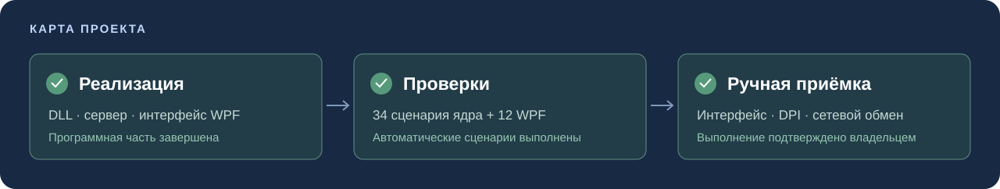
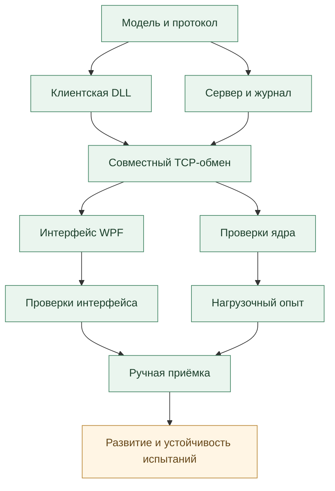

# План развития LogCollector

**Распределённая система сбора и фильтрации логов с агрегацией по уровням.**

Карта объединяет результаты разработки, критерии проверки и дальнейшие технические задачи. Состояние на **12.10.2026**. Ручная приёмка отмечена как выполненная по подтверждению владельца проекта; автоматические результаты связаны с протоколами прогонов.

[Этапы](#обзор-этапов) · [Зависимости](#зависимости-этапов) · [Реализация](#программная-часть) · [Проверки](#проверки-и-апробация) · [Приёмка](#ручная-приёмка) · [Развитие](#оставшиеся-задачи) · [README](README.md)

## Обзор этапов

| Этап | Основной результат | Состояние | Материал |
| --- | --- | --- | --- |
| Проектирование | Модель, кадры, потоки и ограничения | Завершён | [Архитектура](docs/ARCHITECTURE.md), [протокол](docs/PROTOCOL.md) |
| Сервер и библиотека | События, фильтры, агрегаты и журнал | Завершён | [Исходники](src) |
| Интерфейс | WPF с управлением, снимком и отменой | Завершён | [MainWindow](src/LogCollector.AdminWpf/MainWindow.cs) |
| Автоматические проверки | 34 сценария ядра и 12 сценариев WPF | Выполнены | [Результаты](docs/testing/REPORT.md) |
| Локальная нагрузка | Восемь агентов и сверка 91184 событий | Выполнена 05.10.2026 | [Отчёт](docs/testing/load/LOAD_REPORT.md) |
| Ручная приёмка | Основные действия, клавиатура и размеры | Выполнена | [Статус](#ручная-приёмка) |
| Целевая среда | Другой компьютер, DPI и сетевой обмен | Проверена | [Статус](#ручная-приёмка) |
| Устойчивость теста таймаута | Медленная передача и исход закрытия TCP | Требует разбора | [Задачи](#оставшиеся-задачи) |

## Зависимости этапов

Зелёным отмечены реализованные компоненты и выполненные этапы проверки. Дальнейшие изменения и незавершённые технические задачи выделены отдельно.

## Проектные решения

| Решение | Критерий | Подтверждение |
| --- | --- | --- |
| Тип, длина и тело кадра | Границы независимы от чтений TCP | Фрагментация и склейка |
| Две роли | Агент отправляет записи, администратор меняет правила | Права и приветствие |
| Правило по имени | Изменение действует на все соединения источника | Одноимённые агенты |
| Общая блокировка | Снимок согласован с записью | Параллельные изменения |
| Ограниченные ресурсы | Соединения, правила и запросы имеют пределы | Лимиты и сроки |
| Определённый отказ | Нет STORED после ошибки записи | Инъекция отказа |

Спецификации: [архитектура](docs/ARCHITECTURE.md), [протокол](docs/PROTOCOL.md), [отказы](docs/FAILURE_MODES.md).

## Программная часть

### Модель и клиентская библиотека

- [x] LogRecord: UTC, уровень, источник и сообщение.
- [x] Проверка Unicode, длины, управляющих символов и уровня.
- [x] Protocol: строгая UTF-8 и явные границы полей.
- [x] RemoteLogger: отправка событий и результаты STORED/FILTERED.
- [x] AdminClient: изменение порога и получение состояния.
- [x] ServerStatus: неизменяемый проверенный снимок.
- [x] DemoAgent: отдельный пример подключения DLL.

**Критерий:** стороннее приложение использует LogCollector.Common.dll и LogCollector.Client.dll, а ответ соответствует решению сервера.

### Сервер и хранилище

- [x] Приём TCP, поток на сеанс и лимит подключений.
- [x] Регистрация роли и постоянного имени источника.
- [x] Учёт нескольких соединений с одинаковым именем.
- [x] Изменение минимума без перезапуска.
- [x] Четыре массива счётчиков по пяти уровням.
- [x] Общий файл и последовательность сегментов при ротации.
- [x] Подтверждение после записи и Flush.
- [x] Остановка записи после частичной ошибки.
- [x] Восстановление незавершённой последней строки.
- [x] Закрытие listener, сеансов и файла при остановке.

**Критерий:** подтверждения, счётчики и физические строки совпадают; потеря ответа не вызывает скрытого повтора.

### Интерфейс администратора

- [x] Встроенная XAML-разметка и стандартные элементы WPF.
- [x] Адрес, порт, скрытый токен и состояние соединения.
- [x] Источники, пять уровней и карточки общих сумм.
- [x] Выбор источника и новый минимальный уровень.
- [x] Ручное обновление и DispatcherTimer.
- [x] Фоновый TCP без обращения к контролам из рабочего потока.
- [x] Одна ожидающая операция и передача через Dispatcher.
- [x] Поколение для отбрасывания позднего ответа.
- [x] Очистка снимка при отключении и ошибке.
- [x] История подтверждений и ошибок текущего окна.

**Критерий:** данные отображаются после проверки снимка; отмена и закрытие не ждут завершения сетевого чтения.

## Проверки и апробация

### Автоматические сценарии

| Область | Нормальные случаи | Отказы и границы |
| --- | --- | --- |
| Запись | Уровни, UTC, Unicode и пустой текст | Неверный уровень, длина и управляющие символы |
| Кадр | Раздельная и совместная доставка | Обрыв, длина, тип, UTF-8 и лишнее тело |
| Соединение | Регистрация и независимые клиенты | Роль, токен, источник и незавершённое приветствие |
| Фильтры | Все пороги и работающий источник | Предел правил и одновременное изменение |
| Статистика | Согласованный снимок и точные суммы | Неверный снимок и переполнение итогов |
| Хранение | Общий журнал, ротация и перезапуск | Недоступный сегмент и частичная запись |
| WPF | Фильтр, обновление и новое подключение | Зависший ответ, отмена, поздний результат и закрытие |

- [x] Выполнены 34 сценария ядра.
- [x] Выполнены 12 сценариев настоящего WPF.
- [x] Собраны восемь проектов из чистой копии.
- [x] Проверочные программы выполнены отдельно после сборки.
- [x] Протоколы и снимки интерфейса сохранены.

**Доказательства:** [чистая сборка](docs/testing/clean-build-output.txt), [отчёт](docs/testing/REPORT.md).

### Локальная нагрузка

| Условие или результат | Значение |
| --- | ---: |
| Дата | 05.10.2026 |
| Агентов / длительность | 8 / 180,064 с |
| Получено / сохранено / отфильтровано | 91184 / 55620 / 35564 |
| Ошибок / повторных идентификаторов | 0 / 0 |
| Изменений порога / сегментов | 177 / 52 |
| Тестовый предел сегмента | 262144 байт |

- [x] Ответы сопоставлены со всеми пятью уровнями снимка.
- [x] Число строк совпало с STORED.
- [x] Идентификаторы и размеры сегментов проверены.
- [x] CSV и конечный снимок сохранены.

Опыт выполнен на одном компьютере через loopback TCP. Ручная проверка обмена между компьютерами выполнена отдельно. Длительная эксплуатация в реальной сети остаётся направлением дальнейших испытаний.

## Ручная приёмка

Ручное тестирование выполнено. Результаты дополняют автоматические протоколы проверки компонентов.

| Область | Проверяемый результат | Состояние |
| --- | --- | --- |
| Основной сценарий | Запуск, подключение, источники, фильтр и статистика | Выполнено |
| Ошибки и восстановление | Ошибка ввода, отключение и повторное подключение | Выполнено |
| Клавиатура | Переходы Tab/Shift+Tab и доступ к действиям | Выполнено |
| Отображение | Целевой DPI, размеры окна и читаемость | Выполнено |
| Другая машина | Запуск программы в целевой среде | Выполнено |
| Сетевой обмен | Сервер и клиент на двух компьютерах | Выполнено |

- [x] Ручной сценарий выполнен.
- [x] Клавиатура и целевой DPI проверены.
- [x] Запуск на другой машине проверен.
- [x] Обмен между компьютерами проверен.

## Оставшиеся задачи

| Задача | Причина | Критерий завершения |
| --- | --- | --- |
| Сценарий медленной передачи | Один прогон получил сброс TCP вместо кадра ошибки | Разобран исход закрытия и подтверждён общий срок кадра |
| Длительная сетевая эксплуатация | Локальная нагрузка не определяет поведение любой сети | Прогоны с задержками и учётом ресурсов |
| Физический отказ хранения | Инъекция записи не заменяет потерю питания | Отдельный опыт с проверкой восстановления |

- [ ] Разобрана нестабильность сценария медленной передачи: в одном прогоне 12.10.2026 получен сброс TCP вместо кадра ошибки; повторные полные прогоны успешны.
- [ ] Выполнены дополнительные длительные испытания в реальной сети.
- [ ] Проверены последствия физического отказа накопителя и потери питания.

## Возможные расширения

Работы относятся к дальнейшему развитию и не входят в текущую реализацию.

| Направление | Что добавляется | Что проверить |
| --- | --- | --- |
| Защищённый транспорт | TLS библиотечного и административного каналов | Сертификаты и ошибки доверия |
| Сохранение правил | Пороги после перезапуска | Целостность и совместимость |
| Политика хранения | Общий объём и срок архивов | Закрытые сегменты и история |
| Стратегия доставки | Идентификаторы и неизвестный исход | Дубли, повтор и подтверждение |

## Навигация по результатам

| Нужно найти | Ссылка |
| --- | --- |
| Общее описание и запуск | [README](README.md) |
| Компоненты и потоки | [Архитектура](docs/ARCHITECTURE.md) |
| Поведение при сбое | [Отказы](docs/FAILURE_MODES.md) |
| Команды и данные | [Протокол](docs/PROTOCOL.md) |
| Запуск и сеть | [Эксплуатация](docs/OPERATIONS.md) |
| Автоматические результаты | [Отчёт проверок](docs/testing/REPORT.md) |
| Условия нагрузки | [Нагрузочный опыт](docs/testing/load/LOAD_REPORT.md) |
