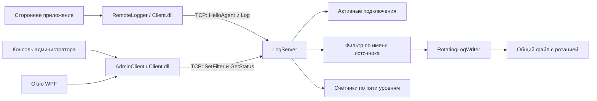
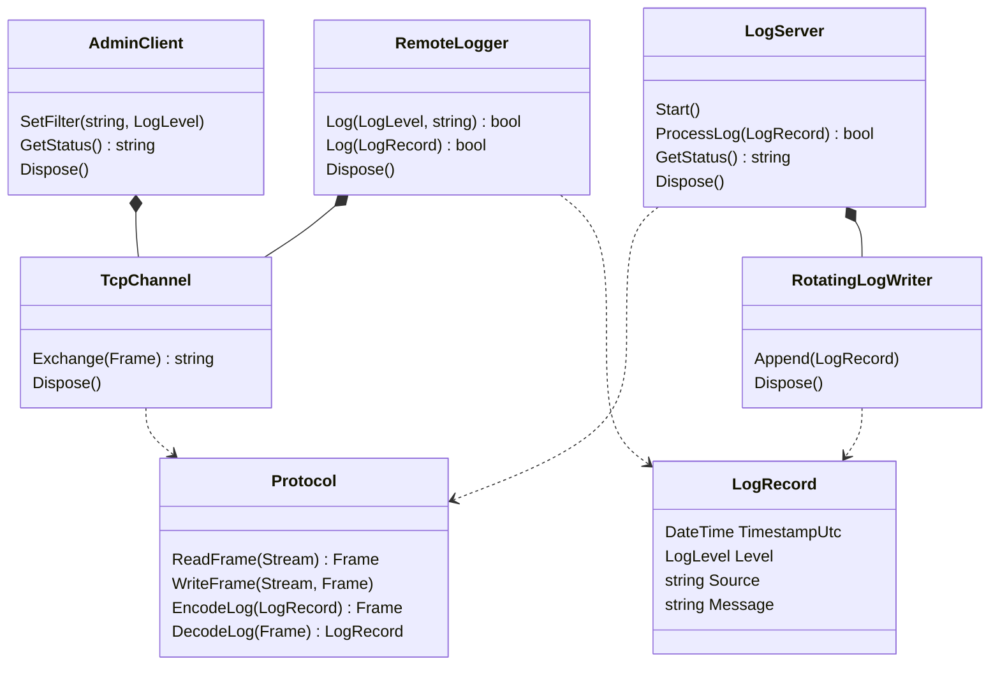

# Архитектура реализованной системы

Стек: C# 5 / .NET Framework 4.8. Сокеты `TcpListener`, `TcpClient`, обычные `Thread`, файловый `FileStream`. Сторонних пакетов нет. Графический интерфейс реализован на стандартных WPF.

## Функциональная схема

Сервер центральный, но источники распределённые: библиотека может быть включена в независимые приложения на других компьютерах. Автоматические прогоны подтверждают локальный TCP. Ручная проверка между компьютерами отмечена как выполненная по подтверждению владельца проекта.

## Состав решения и взаимодействие классов

| Проект | Назначение | Зависимости |
| --- | --- | --- |
| LogCollector.Common | LogRecord, LogLevel, Frame, Protocol | Только .NET Framework |
| LogCollector.Client | Публичные RemoteLogger и AdminClient; внутренний TcpChannel | Common |
| LogCollector.Server | Многопоточный LogServer, RotatingLogWriter, консольный запуск | Common |
| LogCollector.DemoAgent | Пример стороннего приложения, отправляющего пять уровней | Client, Common |
| LogCollector.AdminConsole | Изменение порога и чтение состояния через TCP | Client, Common |
| LogCollector.AdminWpf | Окно администратора и фоновая обработка TCP-запросов | Client, Common, штатные WPF |
| LogCollector.Tests | Исполняемый набор модульных и интеграционных проверок | Common, Client, Server |
| LogCollector.UiTests | Проверка формы в STA-потоке и её TCP-сценариев | AdminWpf, Common, Client, Server |

Классы не требуют искусственной глубокой иерархии наследования: используются композиция и `IDisposable`. 

## Алгоритм и синхронизация

1. Поток приёма ждёт TCP-подключения, проверяет лимит, добавляет сеанс и запускает отдельный поток.
2. Поток сеанса проверяет приветствие агента или администратора; до завершения приветствия установлен таймаут. Имя источника хранится у каждого соединения, а не только в словаре по имени.
3. Для корректной записи агента сервер под общей блокировкой увеличивает RECEIVED, получает порог имени, отбрасывает ниже порога или пишет через RotatingLogWriter. Затем обновляет FILTERED / STORED / FAILED и отвечает.
4. Команда администратора SetFilter использует ту же блокировку: правило меняется во время работы без переподключения агента. GetStatus формирует согласованный снимок.
5. При выходе поток закрывает сокет и удаляет свой сеанс. Закрытие одного из двух одинаково названных источников не удаляет другое соединение.
6. При остановке сервер прекращает приём, закрывает активные сокеты, ждёт завершения потоков и закрывает файл. Ожидание потоков выполняется вне блокировки состояния.

Глобальная блокировка делает алгоритм понятным и проверяемым, но последовательная запись файла ограничивает пропускную способность. На первом этапе выбран прямой поток обработки вместо очередей и брокеров; будущую производительность нужно измерить, а не обещать.

## Схема данных

- LogRecord: immutable для вызывающего кода, UTC-метка, перечисление уровня, имя, сообщение.
- ServerStatus: проверенный неизменяемый снимок для отображения, коллекции LevelStatistics и SourceStatus только для чтения, безопасные итоговые суммы.
- Сеанс: TcpClient, рабочий Thread, имя агента либо null для администратора / ожидающего приветствия.
- Фильтры: `Dictionary<string, LogLevel>`, имена с ordinal-сравнением, значения в памяти.
- Статистика: четыре массива Int64 длины 5. Индекс соответствует значению уровня.
- Журнал: `logs-000001.log`, `logs-000002.log` и т.д.; одна активная запись для всех источников, UTF-8 без BOM.
- Физическая строка: ISO 8601 UTC, уровень, имя, текст с разделителем TAB. Обратная косая черта и управляющие символы экранируются, чтобы сообщение не создавало ложную новую запись.

При ротации лимит проверяется до следующей записи; нельзя разрывать одну запись между файлами. После перезапуска используется последний существующий индекс и режим Append. Одновременно два сервера в одной папке данных не поддерживаются: файловая блокировка предотвращает совместную запись.

## Интерфейс WPF

WPF использует AdminClient.GetSnapshot и TCP, не читает серверные файлы напрямую. Фоновый запрос отделён от UI; завершение возвращается через Dispatcher.BeginInvoke, устаревшие поколения соединения отбрасываются. TcpChannel.Dispose прерывает сетевое ожидание без блокировки интерфейса. Проверки ядра и окна выполнены. Дальнейшие технические задачи отражены в [ROADMAP](../ROADMAP.md#оставшиеся-задачи).
